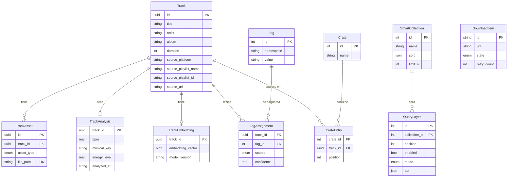

# WaveLoad — Arquitectura

> Documento de referencia estable. Cambia poco: solo cuando se toma o se revierte una
> decisión de arquitectura. El estado del trabajo vive en `ESTADO.md`.
>
> Convención: `[PENDIENTE: x]` marca algo que todavía no está decidido. No se rellena
> con suposiciones.

---

## 1. Qué es WaveLoad

WaveLoad es una aplicación de escritorio para Windows dirigida a DJs, que integra en un
solo flujo lo que hoy está partido entre tres o cuatro herramientas: buscar y descargar
material, limpiar sus metadatos, mantener la librería local y construir colecciones a
partir de ella. La diferencia con Rekordbox, Serato o Traktor no está en la
reproducción —WaveLoad no es un software de performance— sino en la etapa anterior: la
preparación. Rekordbox organiza con crates manuales y smart playlists de lógica plana
(una lista de condiciones unidas por AND u OR); WaveLoad organiza con un motor de tags y
queries por capas, donde una colección es una pila de filtros ordenada, inspeccionable y
editable capa por capa. A eso se suma que la descarga y el etiquetado están adentro del
mismo programa, no en un conversor web separado.

---

## 2. Principios de diseño

1. **La librería es la fuente de verdad, no la carpeta.** El estado vive en SQLite. El
   sistema de archivos es un detalle de almacenamiento, no la organización.
2. **La lógica de negocio no conoce Qt.** Todo lo que está en `services/`, `domain/` y
   `core/` es puro y testeable sin levantar una ventana. La UI consume, no decide.
3. **Nada destructivo sin reversa.** Las migraciones son idempotentes y transaccionales;
   la deduplicación conserva el registro más antiguo; se hacen backups de la DB antes de
   operaciones masivas.
4. **Determinismo antes que magia.** El análisis armónico, el scoring de transiciones y
   el ordenamiento de sets son algoritmos explicables con parámetros visibles, no cajas
   negras. Cuando entre IA, entra como una fuente de tags más, marcada como tal y
   distinguible de lo que puso el usuario.
5. **Todo lo que se muestra, funciona.** No hay entradas de navegación en estado
   "Próximamente". Si no está construido, no está en la UI (por eso "Colecciones" está
   oculto hoy en `ui/shell/sidebar.py`).
6. **Los datos del usuario sobreviven a WaveLoad.** Los tags se escriben también al ID3
   del archivo. Si el programa desaparece, el trabajo de curaduría no se pierde.
7. **Una sola fuente de configuración.** `SettingsService` es la única autoridad sobre
   ajustes; ningún módulo lee configuración por su cuenta.
8. **Escala objetivo: 50.000+ tracks.** Toda decisión de consulta u organización se juzga
   contra ese número, no contra los 784 tracks de la librería actual.

---

## 3. Modelo de dominio

### Entidades existentes

| Entidad | Qué es | Atributos principales |
|---|---|---|
| `Track` | Agregado raíz. La entrada permanente de la librería. | `id` (UUID), `title`, `artist`, `album`, `duration`, `created_at`, `updated_at`, `source_platform`, `source_playlist_name`, `source_playlist_id`, `source_url`, `bpm`, `key_camelot`, `energy` |
| `TrackAsset` | Archivo físico o dato asociado a un Track. | `id`, `track_id`, `asset_type` (`AUDIO_MP3`/`AUDIO_WAV`/`AUDIO_FLAC`/`THUMBNAIL`), `file_path` (UNIQUE en DB), `created_at`, `updated_at` |
| `DownloadItem` | Tarea transitoria de la cola de descarga. Vive solo mientras dura la descarga. | `id`, `url`, `title`, `output_dir`, `state`, `progress_text`, `retry_count`, `max_retries`, `final_mp3_path`, `temp_download_path` |

`Track` y `DownloadItem` están deliberadamente separados: uno es la librería permanente,
el otro es estado de cola. El puente es el evento `TrackDownloadedEvent`, que
`TrackService` convierte en `Track`. **No se deben fusionar.**

### Entidades del motor de Collections (a construir)

| Entidad | Qué es | Atributos principales |
|---|---|---|
| `Tag` | Etiqueta del vocabulario, con namespace. | `id`, `namespace`, `value` (único por par) |
| `TagAssignment` | Asignación de un tag a un track, con su procedencia. | `track_id`, `tag_id`, `source` (`manual`/`derived`/`inherited`/`ai`), `confidence`, `created_at` |
| `SmartCollection` | Colección dinámica: pila ordenada de capas de query. Se re-evalúa siempre. | `id`, `name`, `layers[]`, `sort`, `limit`, `created_at`, `updated_at` |
| `QueryLayer` | Una capa de la pila. | `id`, `collection_id`, `position`, `enabled`, `mode` (`filter`/`exclude`/`union`), `ast` (JSON) |
| `Crate` | Colección manual: lista ordenada y fija de tracks. | `id`, `name`, `created_at`, `updated_at` |
| `CrateEntry` | Un track dentro de un crate, con su posición. | `crate_id`, `track_id`, `position` |

`SmartCollection` y `Crate` son entidades **separadas**, no dos modos de una misma cosa.
Una smart collection no admite tracks fijados a mano ni exclusiones puntuales: si querés
control manual sobre el resultado, se materializa a un crate.

`[PENDIENTE: definir si existe una acción "congelar a crate" que convierta el resultado de
una smart collection en un crate, y si ese crate guarda referencia a la collection de
origen.]`



`DownloadItem` queda fuera del diagrama de relaciones a propósito: no tiene clave foránea
a `Track`. La única conexión entre ambos es el evento `TrackDownloadedEvent`.

---

## 4. El motor de tags/queries por capas

Esta es la fundación del producto. Todo lo demás —el grafo, el set builder, los exports—
consume lo que este motor produce.

### 4.1 Tags: namespace y valor

Un tag es siempre `namespace:value`. El namespace es vocabulario controlado (el conjunto
de namespaces se define una vez y es cerrado en el uso diario); el valor es libre dentro
de su namespace. Ejemplos: `genre:techno`, `mood:dark`, `context:peak-time`,
`energy:high`.

Que el namespace sea obligatorio es lo que hace legibles y componibles las capas de
query: una capa opera sobre un eje, no sobre una nube de etiquetas sueltas.

`[PENDIENTE: definir el set inicial de namespaces de v1, y si el usuario puede crear
namespaces nuevos desde la UI o solo valores dentro de los existentes.]`

### 4.2 Procedencia de los tags

Cada asignación guarda de dónde salió. Las cuatro fuentes de v1:

| `source` | Origen | Estado |
|---|---|---|
| `manual` | El usuario etiqueta desde la librería o el context panel, individual o en lote. | A construir |
| `derived` | Se derivan del análisis que ya corre: `bpm`, `key_camelot`, `energy` → tags. 781 de 784 tracks ya están analizados. | Análisis hecho; derivación a construir |
| `inherited` | `source_platform` y `source_playlist_name` se convierten en tags al importar o descargar. Las columnas ya existen y se pueblan. | A construir |
| `ai` | Clasificación automática de género/mood por modelo. Depende de `track_embeddings`, hoy en 0 filas. | No existe nada. Es el ítem de mayor riesgo de v1 — ver `ESTADO.md` |

Los tags `derived` se recalculan cuando se re-analiza un track; los `manual` nunca se
tocan automáticamente.

`[PENDIENTE: política de conflicto. Qué pasa cuando una fuente automática asigna
genre:techno y el usuario había puesto manualmente genre:minimal — ¿coexisten, gana el
manual, o el manual bloquea futuras asignaciones automáticas en ese namespace?]`

`[PENDIENTE: umbral de confianza mínimo para materializar un tag de IA, y si los tags de
IA se muestran visualmente distintos de los manuales.]`

### 4.3 Las capas

Una `SmartCollection` es una **pila ordenada de capas**. La base implícita es la librería
completa. Cada capa recibe el conjunto que produjo la anterior y lo transforma según su
`mode`:

- `filter` — se queda con los tracks del conjunto que cumplen el predicado (intersección).
- `exclude` — saca del conjunto los que cumplen el predicado (diferencia).
- `union` — agrega al conjunto los tracks de la librería que cumplen el predicado.

Cada capa tiene `enabled`, así que se apaga y se prende sin borrarla, y `position`, así
que se reordena. Reordenar cambia el resultado cuando hay capas `union` involucradas: el
orden es semántico, no cosmético.

Ejemplo de una pila de tres capas:

```
base:  librería completa                             → 784
[1] filter   genre:techno OR genre:minimal           → 210
[2] filter   bpm BETWEEN 122 AND 128                 →  94
[3] exclude  context:already-played                  →  71
```

El valor frente al AND/OR plano de una smart playlist de Rekordbox es que cada paso
intermedio es visible y desactivable: se puede apagar la capa 2 y ver inmediatamente qué
aportaba, sin reescribir la condición entera.

`sort` y `limit` se aplican **una sola vez, al final**, sobre el resultado del fold, no
por capa.

### 4.4 El predicado: AST

Cada capa lleva un predicado guardado como AST en JSON. No se guarda texto: el texto —si
más adelante hay un DSL— es una vista sobre el AST, igual que el builder visual. Ambas
interfaces editan la misma estructura.

Tipos de nodo:

- `bool` — `{"op": "and"|"or"|"not", "children": [...]}`
- `tag` — `{"op": "tag", "namespace": "genre", "value": "techno"}`
- `tag_any` — presencia de cualquier valor en un namespace: `{"op": "tag_any", "namespace": "mood"}`
- `range` — sobre campo numérico: `{"op": "range", "field": "bpm", "min": 122, "max": 128}`
- `compare` — `{"op": "compare", "field": "duration", "cmp": "gt", "value": 300}`
- `text` — búsqueda sobre `title` / `artist` / `album`
- `source` — sobre procedencia del track (`source_platform`, `source_playlist_name`)

`[PENDIENTE: cerrar la lista exacta de operadores y campos consultables de v1. Falta
decidir en particular (a) si existe un nodo que referencie a otra collection
(`{"op": "in_collection", "id": N}`), lo que permitiría componer colecciones entre sí, y
(b) si hay predicados temporales (added_before, analyzed_after, never_played) — esto
último requiere columnas que hoy no existen.]`

El AST se versiona con un campo `ast_version` para poder migrar la forma del JSON sin
romper colecciones guardadas.

### 4.5 Evaluación

La evaluación es una compilación, no un recorrido en memoria:

1. Se lee la pila de capas ordenada por `position`, salteando las que tienen
   `enabled = false`.
2. Cada AST se compila a un fragmento de SQL parametrizado. Los nodos `tag` se traducen a
   `EXISTS (SELECT 1 FROM track_tags ...)`; los `range` / `compare` a condiciones sobre
   columnas de `tracks` / `track_analysis`; los `bool` a `AND` / `OR` / `NOT` anidados.
3. Las capas se encadenan como CTEs sucesivas: `layer_0` es la librería, `layer_n` se
   define en términos de `layer_n-1` según su `mode` (intersección para `filter`, `EXCEPT`
   para `exclude`, `UNION` para `union`).
4. `sort` y `limit` se aplican al `SELECT` final.
5. SQLite ejecuta. Los valores viajan siempre como parámetros bindeados, nunca
   interpolados en el string.

No hay caché ni materialización de resultados: una smart collection se recalcula cada vez
que se abre. Con índices sobre `track_tags(tag_id, track_id)`, `track_tags(track_id)` y
sobre las columnas de análisis, esto se sostiene en el orden de magnitud objetivo. Si en
la práctica no se sostiene, la salida es materializar por collection con invalidación por
evento, no cambiar el modelo.

### 4.6 Persistencia

Todo vive en la misma base SQLite de la librería (`waveload_library.db`), agregado por
migración idempotente como las que ya corren en `infrastructure/database.py`:

```
tags(id, namespace, value)                                      UNIQUE(namespace, value)
track_tags(track_id, tag_id, source, confidence, created_at)    PK(track_id, tag_id, source)
collections(id, name, sort_json, limit_n, ast_version, created_at, updated_at)
collection_layers(id, collection_id, position, enabled, mode, ast_json)
crates(id, name, created_at, updated_at)
crate_entries(crate_id, track_id, position)                     PK(crate_id, track_id)
```

`[PENDIENTE: confirmar nombres definitivos de tabla y columna antes de escribir la
migración. Una vez corrida sobre la librería real, cambiarlos cuesta.]`

### 4.7 Salida al archivo (ID3)

Los tags se escriben también al ID3 del MP3 con Mutagen, para que la curaduría sobreviva a
WaveLoad. La escritura es un efecto secundario asíncrono de la asignación, nunca bloquea
la UI, y la DB sigue siendo la fuente de verdad: si el archivo y la DB difieren, gana la
DB.

`[PENDIENTE: decidir a qué frame ID3 se escriben. Opciones sobre la mesa: un TXXX con
clave propia (limpio, invisible para otro software), GRP1 (Rekordbox lo lee como
"Grouping") o COMM. La elección determina si los tags aparecen dentro de Rekordbox sin
importar nada.]`

`[PENDIENTE: definir si la lectura es bidireccional — si al importar un archivo que ya
tiene tags de WaveLoad en el ID3, esos tags se reconstruyen en la DB.]`

---

## 5. Decisiones de arquitectura

| Decisión | Alternativas descartadas | Por qué | Qué la revertiría |
|---|---|---|---|
| **Motor de tags/queries por capas** como fundación de la organización | (1) Modelo de grafos; (2) smart albums estilo Rekordbox; (3) canvas espacial; (4) línea de tiempo | (1) Muy flexible pero demasiado abstracto para flujos rápidos de DJing y difícil de visualizar de forma lineal. (2) Lógica rígida AND/OR plana, sin profundidad ni contexto por capas. (3) Bueno para ordenamiento visual táctil, deficiente para consultas estructuradas sobre 50.000+ tracks. (4) Sirve para secuenciar un set puntual, no escala como motor primario de biblioteca. El motor por capas es el único desacoplado y mantenible a largo plazo | Que en uso real las queries terminen siendo siempre de una sola capa: significaría que el modelo es sobreingeniería y que un smart album plano alcanzaba |
| **Capas apilables** como forma de la query | Una sola expresión booleana AND/OR/NOT | Cada paso intermedio es visible, desactivable y reordenable. Permite entender por qué un track está o no está en el resultado, que es exactamente donde falla la smart playlist tradicional | Que reordenar y desactivar capas no se use nunca en la práctica |
| **`SmartCollection` y `Crate` como entidades separadas** | Modelo unificado (query dinámica + pins + exclusiones en una sola entidad) | Semántica sin ambigüedad en cada una: una es dinámica y siempre viva, el otro es una lista fija que no cambia sola. Familiar para quien viene de Rekordbox | Que en la práctica todas las smart collections terminen convertidas a crates para poder tocarlas a mano: indicaría que hacía falta el híbrido con pins |
| **Query persistida como AST en JSON, compilada a SQL** | (a) DSL de texto parseado en runtime; (b) evaluación en memoria en Python | El AST es la representación única que alimenta tanto un builder visual como un futuro DSL. Compilar a SQL delega el trabajo a SQLite, que es lo que escala a 50.000+ tracks; evaluar en Python obligaría a cargar la librería entera en memoria | Que aparezcan predicados no expresables en SQL (por ejemplo similitud por embeddings), forzando un paso híbrido de evaluación en Python |
| **Sin caché ni materialización de resultados** | Materializar el resultado de cada collection con invalidación por evento | Un recálculo siempre correcto es preferible a una caché que puede quedar desincronizada. La complejidad de invalidación no se justifica hasta medir que hace falta | Medir la evaluación por encima del umbral de latencia aceptable sobre una librería real de decenas de miles de tracks |
| **Tags namespaced `key:value`, namespaces controlados** | (a) Tags planos libres; (b) namespaces y valores ambos fijados por esquema | Los planos se desordenan solos apenas la librería crece. Controlar también los valores obliga a editar un esquema antes de poder etiquetar, lo que rompe el flujo rápido | Que la cantidad de namespaces crezca tanto que dejen de ser vocabulario y pasen a ser ruido |
| **Los tags se escriben también al ID3** | (a) Solo en la DB de WaveLoad; (b) materializarlos únicamente al exportar | El trabajo de curaduría es lo más caro de reproducir y tiene que sobrevivir a la herramienta. Mutagen ya está en el stack | Corrupción o pérdida de metadata en escritura masiva; o que la escritura resulte demasiado lenta sobre librerías grandes |
| **Grafo y set builder como consumidores de Collections** | (a) Congelarlos fuera de v1; (b) mantenerlos como workspaces independientes | Dejan de competir con Collections como modelo de organización y pasan a ser una salida: se arma una collection y desde ahí se genera el grafo o el set. Conserva el código ya construido y probado | Que la integración cueste más que el valor que aporta: en ese caso se congelan |
| **`Track` y `DownloadItem` separados** | Una sola entidad con estado de cola y de librería | Uno es permanente y desacoplado de cómo se obtuvo el archivo; el otro es transitorio y carga progreso, reintentos y rutas temporales. Fusionarlos contamina la librería con estado de descarga | Nada previsto. Está documentado en el código como decisión explícita a no revertir |
| **Servicios puros, sin Qt** | Lógica dentro de los widgets | Permite testear headless: hoy 104 tests corren sin levantar una ventana | Nada previsto |
| **SQLite local como único repositorio persistente**, con inyección de dependencias | Base embebida alternativa; capa ORM; backend remoto | Un archivo, sin servidor, sin cuenta, sin conexión. La inyección permite sustituir el repositorio en tests | Necesidad real de sincronizar entre máquinas |
| **`SettingsService` como única fuente de verdad de configuración** | Configuración leída ad-hoc por cada módulo | Ya resolvió el problema de rutas divergentes según cómo se lanzaba la app | Nada previsto |

---

## 6. Stack técnico

| Pieza | Por qué |
|---|---|
| **Python 3.13** | Ecosistema de audio (librosa, mutagen) y de descarga (yt-dlp) sin equivalente en otro runtime |
| **PySide6 (Qt 6)** | UI de escritorio nativa con licencia LGPL; grillas de alto rendimiento vía modelo/delegate, necesarias para decenas de miles de filas |
| **SQLite** | Sin servidor, un archivo, transaccional. Es además lo que hace viable compilar las queries por capas a SQL |
| **yt-dlp** | Motor de descarga; el único que se mantiene al día con los cambios de las plataformas |
| **FFmpeg** | Conversión y extracción de audio. Dependencia externa del sistema, no un paquete de Python |
| **Mutagen** | Lectura y escritura de ID3. Es lo que permite que los tags viajen con el archivo |
| **librosa + soundfile** | BPM por beat tracking, cromas para tonalidad, RMS para energía |
| **NetworkX** | Grafo de conocimiento: layout force-directed, detección de comunidades, caminos mínimos |
| **aiohttp** | Descargas concurrentes asíncronas |
| **browser-cookie3** | Cookies del navegador para contenido que requiere sesión |
| **Pillow** | Procesamiento de carátulas antes de embeberlas |
| **pytest** | Suite headless sobre los servicios puros |
| **PyInstaller** | Empaquetado a `.exe` sin Python instalado (`WaveLoad.spec`, `console=False`) |

### Estructura de capas

```
domain/          entidades y contratos de repositorio; sin dependencias hacia afuera
application/     casos de uso y bootstrap (import_use_case, analysis_coordinator)
services/        lógica de negocio pura, sin Qt (análisis, similitud, grafo, sets, export)
infrastructure/  DB, esquema, migraciones, autenticación de navegador
storage/         implementaciones concretas de repositorio (SqliteTrackRepository) y stores
core/            descarga, cola, máquina de estados, event bus, config, utils
workers/         hilos Qt que envuelven a los servicios sin contener lógica
ui/              shell, workspaces, componentes, design system (theme/)
```

La comunicación entre la lógica y la UI pasa por el **event bus**
(`core/event_bus.py`): `TrackDownloadedEvent`, `TrackCreatedEvent`. La UI no llama a la
descarga, y la descarga no conoce a la UI.

### Algoritmos ya fijados (parámetros de referencia)

- **Compatibilidad armónica**: rueda Camelot, ventana de BPM ±12%, categorías 0–5 (misma
  clave, relativa, ±1 paso, +2 "boost", +7 "subidón"), resultados interleaved por
  categoría en round-robin.
- **Score de transición**: pesos BPM 0.35 / clave 0.25 / energía 0.15, renormalizados
  sobre las dimensiones disponibles. Género, danceability e historial están declarados con
  peso 0 porque esos datos todavía no existen.
- **Grafo**: umbral de score 70, tope de 6 aristas por nodo (k-NN), layout force-directed
  sembrado con las posiciones previas para que el mapa no salte entre builds.
- **Set builder**: greedy + 2-opt maximizando
  `mean_transition_value − λ · mean_squared_energy_deviation·100`, con λ = 0.6 y cuatro
  curvas de energía por evento (warmup, club, festival, afterhours).
- **Análisis**: perfiles Shaath para tonalidad, ventana de 90 s salteando los primeros
  15 s, sample rate 22.050 Hz, energía calibrada sobre RMS 0.08–0.34 y escalada a 1–10.

---

## 7. Fuera de alcance de v1

Explícito, para no rediscutirlo:

- **Separación de stems** (Demucs/Spleeter). Está en la visión a futuro, no en v1.
- **Generación de mashups y transiciones automáticas.**
- **Integración bidireccional con Rekordbox/Serato/Traktor/Ableton.** v1 exporta a M3U8 y
  XML de Rekordbox, en una sola dirección. No lee de vuelta el estado de esos programas.
- **Sincronización en la nube o entre máquinas.** La librería es local, de una máquina.
- **Multiusuario, colaboración o colecciones compartidas.**
- **Aplicación móvil o web.** WaveLoad es escritorio.
- **Reproducción para performance.** WaveLoad prepara música; no se toca en vivo con él.
- **Streaming.** No se integra con Spotify/Beatport como fuente de reproducción; el
  `spotify_resolver` existente resuelve metadata, no audio.
- **Recomendación por similitud sonora aprendida.** La similitud de v1 es determinista
  (BPM, Camelot, energía). Los embeddings quedan preparados en el esquema, sin uso más
  allá de lo que requiera el tagging por IA.

`[PENDIENTE: definir si macOS entra o queda fuera. Hoy todo el proyecto asume Windows
—rutas, empaquetado, browser-cookie3— pero nunca se decidió explícitamente.]`
